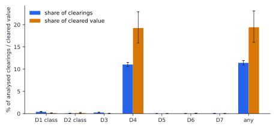
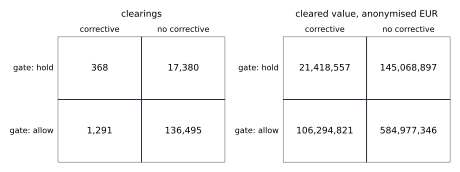
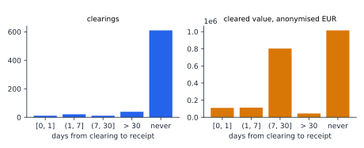
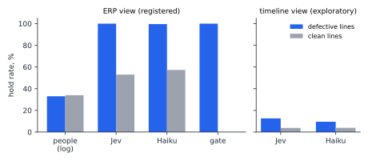

<!-- paper/template.md: the source of paper/paper.md. Every number reaches the paper through a
placeholder filled by scripts/fill_paper.py from a slot file under results/. Draft v0.2. -->

## Abstract

Of the 155,534 analysed invoice clearings of a real purchase-to-pay event log (Section 4 gives the
registered exclusions),
17,748 (11.41%,
clustered bootstrap 95% interval [10.94%, 11.92%]) were made on evidence that
failed at least one of seven registered predicates, carrying 19.41%
of the cleared value ([16.04%, 23.09%]). We replay every analysed clearing
of the BPI Challenge 2019 log through a deterministic min() gate declared before the data were read, over the evidence
reconstructed from the log at clearing time. Clearings made on evidence that failed on the goods receipt (absent or late, D1/D2)
were followed by a corrective event within
60 days at a rate of 5.64%, against 0.93%
for three-way clearings with every applicable predicate passing (difference 0.0470, Holm-adjusted
p = 4.53 × 10^-4^); clearings made after a change of price or quantity since approval (D4 fail), at
1.91% against 0.96%
for D4-pass clearings (difference 0.0094, Holm-adjusted p = 3.48 × 10^-7^).
On a registered sample of lines with a failed predicate and of clean lines, two model families shown the ERP view held
100.0% and 99.6% of the first and
53.0% and 57.3% of the second; on the sample lines the
log lets us classify, people held 33.0% and 34.0%;
the gate's verdict holds the first and allows the second by construction. A line's status at the decision point follows a
reading of D5 (decision D-C-2 B) that the author fixed after E3 and before any model call (Section 4). Paper 5's compiler, given the three declared losses of the registration, does not
reproduce the registered contract in any item category. The coverage matrix states which defect classes this log cannot
expose; the authority defect class (D5) has zero incidence here. No causal claim is made.

## 1 Introduction

Earlier papers of this programme showed the mechanism of a silent evidence defect, a decision taken on evidence that fails a
metadata-borne predicate, on constructed domains, and made no prevalence claim: paper 4 (Besanson 2026) and
paper 5 (Besanson 2026) are on arXiv, and paper 6 is a public repository (Besanson 2026). We
found no record that identifies papers 1 to 3, and do not cite them. This paper is the number, on one real process.

The unit is an invoice clearing in the BPI Challenge 2019 purchase-to-pay log. For each of the
155,534 analysed clearings (the exclusion table of Section 4) we reconstruct the evidence
recorded on the purchase-order line at clearing time, evaluate the registered predicates D1 to D7, record what the gate would
have held, and read what followed in the log. We report exposure in count and in anonymised EUR, the corrective events that
follow a failed predicate, the reach of the gate, and, on a registered sample, what two model families decide on the same
ERP view beside the people in the log and the gate. Everything was registered before the log was parsed beyond its published
counts (tag `prereg-p7-v1`) and amended once after the pilot (v1.1, tag `prereg-p7-v1.1`), with two further deviations
decided after E2 and E3 and before E4; all are listed in Section 4.

What this paper claims is in the claim table of Appendix B. What it does not claim is stated in the repository's claims file
and repeated here verbatim:

- No causal claim. Correctives are a proxy, observational, confounded by vendor, category and practice.
- No loss figure. A corrected payment is not money gone; recovery is not in the log.
- No claim that the gate stops anything. Held lines go somewhere the log does not show.
- No claim about the company or any vendor. No company, subsidiary or vendor is named in any finding.
- No agent acting on the live system and no agent with tools.
- No readiness threshold.

"No claim about the company" means that no company, subsidiary or vendor is named or characterised; the measured process is
the subject of every finding.

## 2 Related work

This paper does not introduce conformance checking, the three-way match or rework analysis. It replays each clearing as a
gate decision over the evidence reconstructed from the event log at clearing time, measures how often that evidence was
defective and what followed, and puts people, models and the gate on the same lines. The defect classes are the predicates
of Section 3.

**Conformance and compliance checking.** Checking recorded behaviour against a normative model or rule set is established
(van der Aalst 2016; Ly et al. 2015), and declarative constraints in the Declare
family take a process model as the conjunction of its constraints (Pesic et al. 2007). The predicates D1 to D7 are
compliance rules in this sense, and taking the decision as their conjunction is Declare's. Synthesising a sufficient contract
from declared losses is paper 5 of this programme (Besanson 2026); the compiler used in Section 5.5 is
paper 5's. Detecting that one resource performed two activities that must be separated is a standard compliance monitoring
functionality (Ly et al. 2015); predicate D5 is that check.

**The BPI Challenge 2019 reports.** The challenge posed the process owner's compliance questions on this very log, including
clearing before goods receipt and the three-way match per item category (ICPM 2019). The submitted
reports measured basic violation rates and are prior art for every basic rate reported here; among them
Diba et al. 2019 quantify receipt-before-clearing violations with their value, and
Porter et al. 2019 report compliance per item category both by number and by value. Measuring compliance by
count and by value is therefore not claimed; what is claimed is the tabulation per clearing and per defect class, with
clustered intervals. The three-way match itself is a textbook application control (PCAOB 2004); Section 5.5 asks
whether paper 5's compiler re-derives it from declared losses.

**Deviation and outcome.** Relating a deviation to a later outcome in the same case is established: the extension of process
mining to outcomes associated with deviations (Peleg et al. 2008), outcome-oriented predictive process
monitoring (Teinemaa et al. 2019) and deviance mining (Nguyen et al. 2016). On this log,
Porter et al. 2019 observe cancellations of invoice receipts long after clearing as a case-study observation.
Corrective events as rework signals are established on this log too: Meyer zu Wickern et al. 2019 count change,
cancel and delete activities as rework, and Badakhshan et al. 2019 list vendor debit memos among rework
activities. The outcome proxy of Section 3 is a rework signal of this kind; H1 to H3 are registered conditional-consequence
studies of the deviation-to-outcome shape.

**Detectability.** That some deviations leave no trace in an event log is established (Outmazgin and Soffer 2013).
The registered per-class coverage matrix of Section 6 is claimed; the principle is not.

**Deciders on the same cases.** Putting different deciders on the same cases is established: a human reviewer, a model agent
and learned rules on the same accounts (Palma et al. 2026), language models against audit baselines on
the same ledgers (Kadir et al. 2025), and algorithms against bank managers (Harding and Vasconcelos 2022).
None of these uses a deterministic contract declared before the data were read, or a human arm read from a process event log;
Section 5.4 does both, with one qualification: the status of a line at the decision point follows a reading of D5 (decision
D-C-2 B) that the author fixed after E3 and before any model call (Section 4).

**The BPI Challenge 2020 reports.** The 2020 challenge posed questions on the approval chain of travel declarations
(ICPM 2020); two reports received awards (ICPM 2020; Pufahl et al. 2020;
Kas et al. 2020). They are prior art for the basic rates of the replication in Section 5.7.

## 3 Formal core

**Lines, clearings and evidence.** A line is one case of the log: one purchase document and item. A clearing is one
`Clear Invoice` event on a line at time t_c. The evidence at t_c is every event on the line with timestamp at most t_c,
excluding the clearing itself, as the registration defines "before t_c" (section 2 of `prereg-p7-v1`, unchanged in v1.1); events sharing a timestamp count as available, and counts rather than event order decide
receipts, blocks and deletions, so the verdict does not depend on the order of events with equal timestamps (a property test
of the replay engine).

**Category and contract.** The case flags select the contract, as the data record states the rules:

| category | GR-based invoice verification | goods receipt | contract |
|---|---|---|---|
| three-way, invoice after receipt (`3-way`) | true | true | D1 to D7 |
| three-way, invoice before receipt (`3-way`) | false | true | D1 to D7 |
| two-way (`2-way`) | false | false | D3 to D7 |
| consignment | any | any | excluded |

**Predicates.** Each predicate takes the value pass, fail or unknown; unknown means a required input is missing.
"Sufficiency-checked" (claim C1) means that each predicate checks that the evidence is present, fresh, valid, authorised and in scope (the
SARC-DQ dimensions of the table); it is not paper 5's sufficiency certificate.

| id | name | dimension | fails when, on the line before t_c |
|---|---|---|---|
| D1 | receipt present | presence | no uncancelled goods receipt (receipts minus receipt cancellations at most zero) |
| D2 | receipt before clearing | freshness, order | no uncancelled receipt precedes t_c |
| D3 | invoice present | presence | no invoice receipt |
| D4 | unchanged since approval | validity | a price or quantity change after the last approval-bearing event |
| D5 | distinct actors | authority | the actor of the clearing equals an actor of the earliest creation (unknown if either is missing) |
| D6 | block respected | scope | payment blocks set minus blocks removed greater than zero |
| D7 | not deleted | validity | deletions plus blocks minus reactivations of the line greater than zero |

At t_c, D1 and D2 have the same truth value; they are kept apart because they carry two dimensions. For reporting only, a
D1/D2 failure is assigned to a defect class by what the log records later: the stale receipt (D2 class) if an uncancelled
receipt is recorded after t_c and by the observation end, the absent receipt (D1 class) otherwise.

**Verdict.** The verdict is min() over the category's contract with pass as one and fail or unknown as zero: the gate allows a
clearing if and only if every applicable predicate passes, and otherwise would have held it. A clearing is defective if at
least one applicable predicate fails; one whose only non-pass value is unknown is held but not defective, and is counted
separately. "Defect" is used only for a failed predicate.

**Human hold.** A line is held by people if a payment block is recorded before its first clearing, or if no clearing is
recorded within W days of its first invoice receipt; a clearing before the first invoice receipt counts as a release.

**Outcome proxy and lag bands.** O = 1 for a clearing if a registered corrective activity (an invoice receipt or goods receipt
cancelled, a price or quantity changed, the line deleted, a vendor debit memo, a subsequent invoice) is recorded on the line
within W after t_c; W = 60 days, with W = 30 days as a descriptive sensitivity. For a D1/D2 failure, the lag from t_c to the
first uncancelled receipt falls in one of the registered bands [0, 1], (1, 7], (7, 30] days, over 30 days, or never.

**Evidence set.** One record per analysed clearing carries the line id (hashed in every export), category, t_c, every
predicate input and value, the verdict, the defect classes, O at both windows, the cleared and line values, and the SHA-256 of
the canonical serialisation of the line's events up to t_c.

## 4 Data and registration

**Data.** The primary log is the BPI Challenge 2019 record; the replication uses the two declaration logs of the BPI Challenge
2020 collection. All three are by Boudewijn van Dongen on 4TU.ResearchData; each file was checked against the hash the
registration records.

| record | DOI | licence | file | cases | events | SHA-256 |
| --- | --- | --- | --- | ---: | ---: | --- |
| BPI Challenge 2019 | doi:10.4121/uuid:d06aff4b-79f0-45e6-8ec8-e19730c248f1 | CC BY 4.0 | `BPI_Challenge_2019.xes` | 251,734 | 1,595,923 | `af63bc687fc4152f2123b05c3af7772b37ef3fce2d3f67f812666c9e356baae7` |
| BPI Challenge 2020: International Declarations | doi:10.4121/uuid:2bbf8f6a-fc50-48eb-aa9e-c4ea5ef7e8c5 | CC BY-NC 4.0 | `InternationalDeclarations.xes.gz` | 6,449 | 72,151 | `b527c8d06255f4312c6ce8f36f7f4110243d84fd6ca48583cd9b80896c601494` |
| BPI Challenge 2020: Domestic Declarations | doi:10.4121/uuid:3f422315-ed9d-4882-891f-e180b5b4feb5 | CC BY-NC 4.0 | `DomesticDeclarations.xes.gz` | 10,500 | 56,437 | `0bc3312acf0b9ee5ae6f4ebe9df204005ef11665d62f2d21dd04995161d7532b` |

Values in the 2019 log are anonymised by a linear translation that respects zero; we report them as anonymised EUR.

**Window, observation end and frame.** A line is in the window if its earliest `Create Purchase Order Item` event lies in
calendar 2018. The observation end T_end is the latest timestamp in the last calendar month that carries at least 1,000
events; here T_end is 2019-01-18 and 9 later
events are excluded. A line is framed if it survives the exclusions below and its first clearing, or its creation if it has
none, lies at least W before T_end; the analysed clearings are every clearing on a framed line at least W before T_end, so
every outcome window is complete. The lines drawn for the pilot (E0) are removed before any estimate. As registered, the
`Item Category` string disagrees with the flag-derived category on 0 of
251,734 lines (section 3.1); every analysed clearing took its value from the clearing event
itself (155,534 clearings; 0
fell back to the invoice receipt and 0 to the line value, section 3.4);
and the seeded 1,000-record sample of the evidence set, identifiers hashed, is exported as `results/e1/evidence-sample.jsonl`
(section 3.9).

| step | lines |
| --- | ---: |
| lines in the log | 251,734 |
| 2.1 (1) no Create Purchase Order Item | 0 |
| 2.1 (2) consignment | 14,498 |
| 3.1 category undefined by the flags | 0 |
| 2.1 (3) zero or missing line value | 1,887 |
| 2.1 (4) more than K = 12 clearings | 78 |
| 2.1 (5) outside the window | 376 |
| 2.1 (5) failing the frame condition | 53,731 |
| framed lines | 181,164 |
| E0 pilot lines removed | 500 |
| framed lines analysed | 180,664 |
| analysed clearings | 155,534 |
| events after T_end excluded | 9 |

**Registration.** The registration was tagged `prereg-p7-v1` before any parse of the log beyond the published counts. The
pilot fired registered stop conditions (the latest timestamp lay outside the registered range, and a mapped attribute is
named differently in the log than on the record page); the registration was amended and tagged `prereg-p7-v1.1`, and the
pilot was drawn again, before any estimate. Every deviation, with the decision that records its reason:

- p7-v1 to p7-v1.1: T_end rule.
- p7-v1 to p7-v1.1: Mapping attribute name.
- p7-v1 to p7-v1.1: Section 3.6, explicit sentence.
- Under p7-v1.1: H3 convention.
- Under p7-v1.1: D5 applicability at a non-clearing decision point.
- Under p7-v1.1: Description corrections in COVERAGE.md, no predicate changes.
- Under p7-v1.1: E7 bootstrap replicates with an empty group discarded.

The H3 convention and the D5 reading were the author's decisions after E2 and E3 and before any model call (decision D-C-2 in
the decision log). The commit order is the evidence: the commit recording D-C-2 (`7aea13f`) precedes the first commit of model
responses (`a475068`). The prior-art fence was reviewed externally after the tag `prereg-p7-v1` and before `prereg-p7-v1.1`,
after two machine sweeps whose output is committed unedited.

## 5 Results

### 5.1 Exposure (E1)

| defect class | clearings | share | Wilson 95% | bootstrap 95% | share of value | bootstrap 95% |
| --- | ---: | ---: | --- | --- | ---: | --- |
| D1 class (absent receipt) | 610 | 0.39% | [0.36%, 0.42%] | [0.30%, 0.50%] | 0.12% | [0.08%, 0.17%] |
| D2 class (stale receipt) | 82 | 0.05% | [0.04%, 0.07%] | [0.02%, 0.10%] | 0.12% | [0.03%, 0.27%] |
| D3 | 362 | 0.23% | [0.21%, 0.26%] | [0.15%, 0.33%] | 0.03% | [0.02%, 0.05%] |
| D4 | 17,157 | 11.03% | [10.88%, 11.19%] | [10.55%, 11.53%] | 19.24% | [15.88%, 22.89%] |
| D5 | 0 | 0.00% | [0.00%, 0.00%] | [0.00%, 0.00%] | 0.00% | [0.00%, 0.00%] |
| D6 | 4 | 0.00% | [0.00%, 0.01%] | [0.00%, 0.01%] | 0.03% | [0.00%, 0.10%] |
| D7 | 19 | 0.01% | [0.01%, 0.02%] | [0.01%, 0.02%] | 0.01% | [0.00%, 0.02%] |
| at least one defect | 17,748 | 11.41% | [11.25%, 11.57%] | [10.94%, 11.92%] | 19.41% | [16.04%, 23.09%] |
| held on an unknown only (not a defect) | 0 | 0.00% | [0.00%, 0.00%] | [0.00%, 0.00%] | 0.00% | [0.00%, 0.00%] |

Figure 1 shows the shares with their intervals. Shares of clearings carry a Wilson and a purchase-document-clustered
bootstrap 95% interval (B = 10,000, seed 20261201); shares of value carry the clustered interval. The denominator is every
analysed clearing, and a share counts the clearings made on evidence that failed the predicate; D1 and D2 classes apply to 155,346 clearings
in the three-way categories. A change after approval (D4) is the largest defect class, 17,157
clearings and 19.24% of cleared value; no clearing fails D5. Appendix D gives the same
shares per defect class, with the clustered intervals, per item category, spend area, month, line value quartile and vendor
activity quartile, reported beside the estimates and never modelled in. Section 4 reports the registered category cross-check,
the cleared-value sources and the exported sample.

### 5.2 Consequence (E2)

| test | defect group (failed predicate): O rate | comparison: O rate | difference | bootstrap SE | z | p (raw, one-sided) | p (Holm) |
| --- | --- | --- | ---: | ---: | ---: | ---: | ---: |
| H1 | 39 of 692 (5.64%) | 1,286 of 137,602 (0.93%) | 0.0470 | 0.0127 | 3.688 | 1.13 × 10^-4^ | 4.53 × 10^-4^ |
| H2 | 327 of 17,157 (1.91%) | 1,332 of 138,377 (0.96%) | 0.0094 | 0.0018 | 5.266 | 6.96 × 10^-8^ | 3.48 × 10^-7^ |
| H3 | 0 of 0 (n/a) | 1,659 of 155,534 (1.07%) | n/a | n/a | n/a | not computable | 1 |

O is the registered corrective within W = 60 days. The H1 comparison group is three-way clearings with every applicable
predicate passing; against clearings of every category with every applicable predicate passing the difference is 0.0470,
descriptively. H2 compares D4 fail with D4 pass in every category. Standard errors come from the purchase-document-clustered
bootstrap. Holm's adjustment runs over the registered family of five tests, H1, H2, H3 and H4 for each model family, at
alpha = 0.05:

| test | p (raw) | rank | multiplier | p (Holm) | below alpha |
| --- | ---: | ---: | ---: | ---: | --- |
| H2 | 6.96 × 10^-8^ | 1 | 5 | 3.48 × 10^-7^ | yes |
| H1 | 1.13 × 10^-4^ | 2 | 4 | 4.53 × 10^-4^ | yes |
| H3 | 1 | 3 | 3 | 1 | no |
| H4-Haiku | 1 | 4 | 2 | 1 | no |
| H4-Jev | 1 | 5 | 1 | 1 | no |

H3, distinct actors, is not computable: defect group has no analysed clearings. No analysed clearing was made by
an actor of its line's earliest creation event, so the defect class has zero incidence; across the log the actors who record a
`Clear Invoice` and those who record the earliest creation of a line are separate populations
(23 and 185
actors, 0 in common; Section 6). H3 enters the family with p = 1, the convention the author
fixed before any H4 value existed (decision D-C-2, commit `7aea13f`). At W = 30 days the differences are 0.0354
for H1 and 0.0055 for H2, descriptively.

### 5.3 Gate effect and hold cost (E3)

The gate would have held 17,748 of 155,534 analysed clearings
(11.41%, 19.41% of cleared value); 0
of them were held on an unknown predicate value alone. Against the corrective at W = 60 days, in clearings and anonymised EUR (Figure 4):

| gate verdict | corrective within W | no corrective within W |
| --- | ---: | ---: |
| would have held | 368 (21,418,557) | 17,380 (145,068,897) |
| would have allowed | 1,291 (106,294,821) | 136,495 (584,977,346) |

For D1/D2 failures, the time from clearing to the first uncancelled receipt (Figure 3):

| lag band | clearings | cleared value |
| --- | ---: | ---: |
| [0, 1] days | 11 | 109,886 |
| (1, 7] days | 21 | 113,119 |
| (7, 30] days | 11 | 803,512 |
| over 30 days | 39 | 44,240 |
| never (by T_end) | 610 | 1,015,565 |

**Human hold.** Of 180,664 framed lines, people held 53,262 and
released 101,777; 25,625 had no invoice
receipt by T_end − W and are not classified. The status of a line is the gate verdict at the decision point t* of the agent
replay: the first clearing if it came within W of the first invoice receipt, otherwise that receipt plus W. The registered
text left D5 at a t* that is not a clearing undefined; read literally it is unknown, and then a line with no clearing within W
can never be clean under the literal reading. The author amended the reading before any model call (at a t* that is not a
clearing, D5 is not applicable: the decider there is the gate or a model; decision D-C-2 B); both readings are reported:

| reading | predicate status at t* | classified lines | held by people | human hold rate |
| --- | --- | ---: | ---: | ---: |
| literal (registered text) | defective | 16,264 | 5,664 | 34.83% |
| literal (registered text) | clean | 91,178 | 1 | 0.00% |
| literal (registered text) | held unknown | 47,597 | 47,597 | 100.00% |
| amended (D-C-2 B) | defective | 16,264 | 5,664 | 34.83% |
| amended (D-C-2 B) | clean | 138,775 | 47,598 | 34.30% |
| amended (D-C-2 B) | held unknown | 0 | 0 | n/a |

Under the amended reading, people held 34.83% of
lines with a failed predicate at t* and 34.30% of clean
lines.

### 5.4 People, models and the gate on the same lines (E4)

**Sample and arms.** From the framed lines with an invoice receipt, 18,006 had at least
one failed predicate at t* and 147,240 were clean, under D-C-2 B (`results/e4/sample-frame.json`).
These differ from the 16,264 and
138,775 lines of Section 5.3 (`results/e3/human-hold.json`),
which are the lines the people arm can classify: a line whose first invoice receipt comes later than T_end − W is eligible
for the sample but not classified (section 3.6). The registered sample
drew 1,000 defective and 1,000 clean lines, at most one per purchase document, stratified by category and value quartile, with
seed 20261201; the draw was committed before any call. Each line was shown to two model families as the registered ERP view at
t*, a short record with no event timeline and no company, vendor, actor or line id: TypeSafe System One (Jev, returned model
`jev-1.14.0`) through `typesafe-sdk==0.7.2`, asked one choice question with labels clear and hold, and the Anthropic Messages API
(`claude-haiku-4-5-20251001`, temperature zero, assistant prefill), asked for a JSON decision and hold probability.
Invalid replies, after one re-request: 0 for Jev and 0 for Haiku. The people arm is read from the log (Section 3);
152 sample lines have no invoice receipt by T_end − W and are not classified (section 3.6), so
its denominators are smaller. The gate's verdict holds every line with a failed predicate and allows every clean line by
construction.

| arm | held, lines with a failed predicate | held, clean lines | kappa with gate | value released on lines with a failed predicate | expected correctives |
| --- | ---: | ---: | ---: | ---: | ---: |
| people (from the log) | 301 of 912 (33.0%) | 318 of 936 (34.0%) | n/a | 4,759,520 | 12.260 |
| Jev | 1,000 of 1,000 (100.0%) | 530 of 1,000 (53.0%) | 0.470 | 0 | 0.000 |
| Haiku | 996 of 1,000 (99.6%) | 573 of 1,000 (57.3%) | 0.423 | 7,307 | 0.076 |
| gate | 1,000 of 1,000 (100.0%) | 0 of 1,000 (0.0%) | n/a | 0 | 0.000 |

| family | d (failed predicate minus clean) | SE | p, lower | p, upper | p_TOST |
| --- | ---: | ---: | ---: | ---: | ---: |
| H4-Jev | 0.470 | 0.0158 | 2.33 × 10^-238^ | 1 | 1 |
| H4-Haiku | 0.423 | 0.0158 | 5.54 × 10^-198^ | 1 | 1 |

Source: `results/e4/arms.json`, `results/e4/h4.json`.

H4 asks whether each family's hold rate on defective lines (a failed predicate) is within m = 0.05 of its rate on clean lines.
Neither is: Jev held 100.0% and 53.0%, Haiku held
99.6% and 57.3%; p_TOST is
1 for Jev and 1 for Haiku, and H4 is below alpha after Holm for
neither. Both families track the gate's verdict on the lines
the gate would have held and hold about half of the lines it allows (Cohen's kappa with the gate
0.470 and 0.423). Released on lines with a failed
predicate, in anonymised EUR: people 4,759,520, Jev
0, Haiku 7,307,
gate 0; for the gate, held lines go somewhere the log does not show.
The expected correctives follow registration section 7: each released line with a failed predicate carries the E2 O rate at
W = 60 days of its defect group, the H1 group if D1/D2 fails and otherwise the H2 group if D4 fails; a line failing neither
(only D3, D6 or D7) has no E2 group and is counted, not imputed (8 sample lines,
1 of them released by people). The ERP view hands each model the
inputs of the predicates; this result is about the view as much as about the models.

**On the lines the people arm classifies.** The same four arms, re-tabulated on the
1,848 sample lines the people arm classifies; the table above, on all sample lines, stays
primary:

| arm | held, lines with a failed predicate | held, clean lines | kappa with gate | value released on lines with a failed predicate | expected correctives |
| --- | ---: | ---: | ---: | ---: | ---: |
| people (from the log) | 301 of 912 (33.0%) | 318 of 936 (34.0%) | n/a | 4,759,520 | 12.260 |
| Jev | 912 of 912 (100.0%) | 491 of 936 (52.5%) | 0.472 | 0 | 0.000 |
| Haiku | 908 of 912 (99.6%) | 524 of 936 (56.0%) | 0.433 | 7,307 | 0.076 |
| gate | 912 of 912 (100.0%) | 0 of 936 (0.0%) | n/a | 0 | 0.000 |

Source: `results/e4/arms-classified-lines.json`; a re-tabulation on the lines the people arm classifies.

**What the people arm measures.** The log records no hold decision except a payment block. "Held by people" (section 3.6)
is a payment block before the first clearing, or no clearing within W of the first invoice receipt: an inferred non-release,
not the same act as a model's hold verdict at t*. Of the 53,262 framed lines held by
people, 10 were held by a payment block alone,
53,182 by no clearing within W alone, and
70 by both:

| reading | predicate status at t* | held by people | payment block before the first clearing | no clearing within W of the first invoice | both |
| --- | --- | ---: | ---: | ---: | ---: |
| literal (registered text) | defective | 5,664 | 9 | 5,619 | 36 |
| literal (registered text) | clean | 1 | 1 | 0 | 0 |
| literal (registered text) | held unknown | 47,597 | 0 | 47,563 | 34 |
| amended (D-C-2 B) | defective | 5,664 | 9 | 5,619 | 36 |
| amended (D-C-2 B) | clean | 47,598 | 1 | 47,563 | 34 |
| amended (D-C-2 B) | held unknown | 0 | 0 | 0 | 0 |

Source: `results/e3/human-hold-composition.json`.

**Exploratory: the event timeline instead of the ERP view.** Labelled exploratory and outside the Holm family: the same lines,
the same families and rules, with the line's events up to t* (date, activity, value) in place of the ERP view.

| family (timeline view, exploratory) | held, lines with a failed predicate | held, clean lines | kappa with gate | invalid replies |
| --- | ---: | ---: | ---: | ---: |
| Jev | 126 of 1,000 (12.6%) | 38 of 1,000 (3.8%) | 0.088 | 0 |
| Haiku | 95 of 1,000 (9.5%) | 39 of 1,000 (3.9%) | 0.056 | 0 |

Source: `results/e4-exploratory/arms-exploratory.json`; exploratory, no interval, outside the Holm family.

Under the timeline view the same models held far fewer lines with a failed predicate (exploratory, no interval). Spend for
both families and both views together was USD 1.57 against the registered cap of USD 60
(`results/e6/cost.json`).

### 5.5 Derivation (E5)

Paper 5's compiler, at the pinned commit and unmodified, was given per category the observed states of the evidence set and
the three declared losses of the registration: L1, pay for goods not received (the category requires a goods receipt and none
is uncancelled); L2, pay twice (the clearing's position among the line's clearings exceeds the invoices recorded); L3, pay a
changed amount (a change since approval). The derived contract is the set of registered predicates whose observation is in
the compiler's minimum-cardinality sufficient set. The comparison is the registered one (registration section 6, E5):
"whether the derived contract equals the category contract in 3.1".

| category | clearings | states | L1 | L2 | L3 | fewest fields | derived contract | registered contract | result |
| --- | ---: | ---: | ---: | ---: | ---: | --- | --- | --- | --- |
| 2-way | 188 | 3 | 0 | 0 | 4 | `changes` | D4 | D3, D4, D5, D6, D7 | does not reproduce |
| 3-way, invoice after receipt | 9,640 | 896 | 0 | 81 | 1,585 | `changes`, `clearing_ordinal`, `invoices` | D3, D4 | D1, D2, D3, D4, D5, D6, D7 | does not reproduce |
| 3-way, invoice before receipt | 145,706 | 758 | 692 | 1,390 | 15,568 | `changes`, `clearing_ordinal`, `invoices`, `receipts` | D1, D2, D3, D4 | D1, D2, D3, D4, D5, D6, D7 | does not reproduce |

The compiler does not reproduce the registered contract in any category. The three losses derive at most D1 to D4: no
declared loss reads the observations of D5, D6 or D7, so those predicates correspond to no declared loss (an authority loss, a
blocked payment, a deleted line would be such losses). In the two three-way categories the derived D1 to D4 is the three-way
match in the narrow sense (receipt, invoice and an unchanged approved amount), and the registered contract carries three
predicates beyond it. Pay twice needs the clearing's position on its line, an observation no registered predicate reads.

### 5.6 Governance cost (E6)

The full replay of every line, from reading the log to the written evidence set, took a median of
153.5 seconds over three runs on a 4-core machine,
0.000987 seconds per gate decision. A model decision cost USD
0.000022 with Jev and USD 0.000368 with Haiku.

### 5.7 Replication on travel declarations (E7)

The unit is a payment on a declaration case at least W before the latest timestamp of its log; D1' approval present, D2'
approval by the required role and D3' unchanged after approval are evaluated before the payment, and O' is a rejection or
resubmission within W after it. Descriptive and secondary, outside the Holm family.

| log | cases | payments | excluded after T_end' − W | units |
| --- | ---: | ---: | ---: | ---: |
| domestic | 10,500 | 10,044 | 2 | 10,042 |
| international | 6,449 | 6,187 | 0 | 6,187 |

| scope | predicate | failing payments | O' rate, failing | O' rate, all-pass | difference | bootstrap 95% |
| --- | --- | ---: | ---: | ---: | ---: | --- |
| domestic | D1' | 2 | 0.500 | 0.000 | 0.500 | [0.0000, 1.0000] |
| domestic | D2' | 2 | 0.500 | 0.000 | 0.500 | [0.0000, 1.0000] |
| domestic | D3' | 0 | n/a | 0.000 | n/a | n/a |
| international | D1' | 0 | n/a | 0.000 | n/a | n/a |
| international | D2' | 0 | n/a | 0.000 | n/a | n/a |
| international | D3' | 0 | n/a | 0.000 | n/a | n/a |
| pooled | D1' | 2 | 0.500 | 0.000 | 0.500 | [0.0000, 1.0000] |
| pooled | D2' | 2 | 0.500 | 0.000 | 0.500 | [0.0000, 1.0000] |
| pooled | D3' | 0 | n/a | 0.000 | n/a | n/a |

The replication is inconclusive. Only 2 of 16,229
payments fail any predicate, and O' follows 0 of the
16,227 payments with every predicate passing; no comparison has an interval
excluding zero. A bootstrap replicate in which either group is empty is discarded and the percentiles are taken over the
retained replicates (8,685 of 10,000
for the domestic log and 8,696 pooled; a pipeline reading recorded in
decision D-D-2). The registered names `Declaration FINAL_APPROVED by DIRECTOR` and
`Declaration REJECTED by DIRECTOR` do not occur in the domestic log; they are reported with zero counts,
not replaced.

## 6 Coverage

What the replay can and cannot see, as registered:

**Detected (BPI 2019, E1 to E6)**

| defect class | predicate | dimension | detected from |
|---|---|---|---|
| goods receipt required but absent at clearing | D1 receipt_present | presence | receipts minus cancellations at most zero before t_c (count of `Record Goods Receipt` minus count of `Cancel Goods Receipt`), on a line whose category requires receipt |
| stale receipt: receipt recorded after clearing | D2 receipt_before_clearing | freshness, order | the first uncancelled `Record Goods Receipt` falls after t_c (lag band registered) |
| invoice absent at clearing | D3 invoice_present | presence | no `Record Invoice Receipt` before t_c |
| changed after approval | D4 unchanged_since_approval | validity | `Change Price` or `Change Quantity` between the last approval-bearing event and t_c |
| same actor created and cleared | D5 distinct_actors | authority | actor of `Create Purchase Order Item` equals actor of `Clear Invoice` |
| clearing under an open payment block | D6 block_respected | scope | count of `Set Payment Block` minus count of `Remove Payment Block` before t_c greater than zero |
| line deleted or blocked at clearing | D7 not_deleted | validity | count of `Delete Purchase Order Item` plus `Block Purchase Order Item` minus `Reactivate Purchase Order Item` before t_c greater than zero |

**Detected (BPI 2020 declarations, E7, secondary)**

| defect class | predicate | dimension | detected from |
|---|---|---|---|
| paid without an approval event | D1' approval_present | presence | no event in the registered approval list before the payment |
| approved by a role other than the required one | D2' approval_by_required_role | authority | the approval chain before payment lacks the registered required role |
| declaration changed after approval | D3' unchanged_since_approval | validity | a resubmission by the employee between the last approval and payment |

**Undetected, with reason**

| defect class | reason |
|---|---|
| wrong amounts in the payload | values are anonymised by a linear translation; the log carries cumulative net worth per event, not invoice line content, so a mismatch between invoice text and goods is not observable |
| fraud | intent is not an event attribute; no predicate over the log separates a fraudulent clearing from an erroneous one, and the paper makes no statement about it |
| vendor identity (wrong, duplicate or fictitious vendor) | vendor names and ids are anonymised consistently; the log carries no master-data change history or bank details |
| recovery of corrected payments | the log records the corrective event and nothing about recovery; whether money was returned, offset or written off is not recorded |
| what a held line becomes | a gate hold is a replay verdict; the log records the human path only, so the fate of a line the gate would have held is not observable |
| approvals outside the log | approvals given by e-mail, in another system or verbally leave no event; D4's "last approval-bearing event" sees only logged approvals |
| partial receipt and value mismatch per receipt | the replay checks presence and order of the receipt, not the matched values; values are anonymised and the registered mapping reads no per-receipt quantity |
| duplicate invoice across lines | the case is one purchase-order line and the registered mapping carries no invoice document id, so an invoice cleared on two lines is not linked |

Per class, the failures found (BPI 2019 on analysed clearings, BPI 2020 on payments):

| log | predicate | failed | unknown |
| --- | --- | ---: | ---: |
| BPI 2019 (analysed clearings) | D1 | 692 | n/a |
| BPI 2019 (analysed clearings) | D2 | 692 | n/a |
| BPI 2019 (analysed clearings) | D3 | 362 | n/a |
| BPI 2019 (analysed clearings) | D4 | 17,157 | n/a |
| BPI 2019 (analysed clearings) | D5 | 0 | n/a |
| BPI 2019 (analysed clearings) | D6 | 4 | n/a |
| BPI 2019 (analysed clearings) | D7 | 19 | n/a |
| BPI 2020 domestic (payments) | D1' | 2 | 0 |
| BPI 2020 domestic (payments) | D2' | 2 | 0 |
| BPI 2020 domestic (payments) | D3' | 0 | 2 |
| BPI 2020 international (payments) | D1' | 0 | 0 |
| BPI 2020 international (payments) | D2' | 0 | 0 |
| BPI 2020 international (payments) | D3' | 0 | 0 |

Sources: `results/e1/coverage-check.json`, `results/e7/predicates.json`.

On BPI 2019 every detected class fails at least once except the authority class (D5), with
0 failed clearings: across the log, the
23 actors who record a `Clear Invoice` and the
185 who record a line's earliest creation share
0, so the two are separate populations; no `Clear Invoice` is recorded by a batch user (an
actor whose name starts with the registered batch prefix), and 7,941 carry no
actor (`results/e1/actors.json`). D5 fires on synthetic lines in the engine's tests (`test_d5_actors` and
`test_verdict_at_decision_point_d5_off_clearing` in `tests/test_engine_units.py`, and fixture line C in `tests/test_pipeline.py`). On BPI 2020, D3' fails on no payment in
either log, and in the international log no predicate fails at all.

## 7 Limitations and non-claims

The outcome is a proxy: a corrective event after a clearing is not proof that the clearing was wrong, and the study is
observational. Category, spend area, value, vendor activity and month are reported beside every estimate and never modelled
in. Values are anonymised. What a line the gate would have held becomes is not in the log. The ERP view hands the model the
inputs of the predicates; under the timeline view the same models held far fewer lines (exploratory, no interval), which is
a statement about views, not about the models alone. The derivation depends on how the three declared losses are expressed over
the evidence set; the expressions are recorded with the result. One company's process, one year.

## 8 Conclusion

11.41% of the 155,534 analysed invoice
clearings in this process were made on evidence that failed at least one registered predicate, carrying
19.41% of the cleared value; those made with an absent or late receipt
(D1/D2) were followed by a corrective at a higher rate than three-way clearings with every applicable predicate passing, and
those made after a change since approval (D4 fail) at a higher rate than D4-pass clearings.

## Acknowledgements

The prior-art fence was reviewed externally by Eduardo Arana after the tag `prereg-p7-v1` and before `prereg-p7-v1.1`, and
he reviewed draft v0.1. AI tools were used as support: builder sessions with Claude for the code, the runs and the drafting
from slots; two machine prior-art sweeps, on ChatGPT and on Perplexity Computer (for the second the serving model cannot be
confirmed: a later session on the platform reports its model as `Claude Opus 5.5` and states that it produced the sweep); and
two machine reviews of draft v0.1, on ChatGPT and on Perplexity Computer (model as
it states it: `Claude Opus 5.5`). All are committed unedited. The author is solely responsible for every claim. We thank the organisers of the BPI
Challenges and 4TU.ResearchData for the logs.

## References

- <!-- ref:bpi2019-nonstudent-4-badakhshan -->Peyman Badakhshan, Samuel Gosling, Jerome Geyer-Klingeberg, Janina Nakladal, Johannes Schukat, Jennifer Gsenger (2019). Process Mining in the Coatings and Paints Industry: The Purchase Order Handling Process. BPI Challenge 2019 report, non-student category, ICPM 2019. https://icpmconference.org/2019/wp-content/uploads/sites/6/2019/07/BPI-Challenge-Submission-4.pdf
- <!-- ref:besanson-paper4-2026 -->Gaston Besanson (2026). One Gate Is Not Enough: Composing Stateful Pre-Action Controls for Agentic AI. arXiv:2608.18360 (paper 4 of the SARC series; repository sarc-suite-one-pass). https://arxiv.org/abs/2608.18360
- <!-- ref:besanson-paper5-2026 -->Gaston Besanson (2026). Compiling Sufficient Governance Context from Declared Losses and Reachable States: Exact Observation-Contract Synthesis with Cardinality and Cost Objectives. arXiv:2609.26016 (paper 5 of this programme; CITATION.cff of sarc-authority-derivation). https://arxiv.org/pdf/2609.26016
- <!-- ref:besanson-paper6-repo-2026 -->Gaston Besanson (2026). gigo-jev-probe: a preregistered probe of a model as an advisory data-quality critic (paper 6 of the SARC series). public GitHub repository besanson/gigo-jev-probe, pinned in engines.lock at e1fc75b. https://github.com/besanson/gigo-jev-probe
- <!-- ref:bpi2019-nonstudent-6-diba -->Kiarash Diba, Simon Remy, Luise Pufahl (2019). BPI Challenge 2019: Performance and Compliance Analysis of Procurement Processes Using Process Mining. BPI Challenge 2019 report, non-student category, ICPM 2019. https://icpmconference.org/2019/wp-content/uploads/sites/6/2019/07/BPI-Challenge-Submission-6.pdf
- <!-- ref:harding-managers-machines-2022 -->Matthew Harding, Gabriel F. R. Vasconcelos (2022). Managers versus Machines: Do Algorithms Replicate Human Intuition in Credit Ratings?. arXiv:2202.04218 (submitted 2022-02-09). https://arxiv.org/abs/2202.04218
- <!-- ref:icpm-bpi-challenge-2019-page -->ICPM 2019 (2019). BPI Challenge 2019 (ICPM 2019 conference page). https://icpmconference.org/2019/bpi-challenge/
- <!-- ref:icpm-2020-awards-page -->ICPM 2020 (2020). Awards (ICPM 2020). https://icpmconference.org/2020/awards/
- <!-- ref:icpm-bpi-challenge-2020-page -->ICPM 2020 (2020). BPI Challenge 2020 (ICPM 2020 conference page). https://icpmconference.org/2020/bpi-challenge/
- <!-- ref:kadir-auditcopilot-2025 -->Md Abdul Kadir, Sai Suresh Macharla Vasu, Sidharth S. Nair, Daniel Sonntag (2025). AuditCopilot: Leveraging LLMs for Fraud Detection in Double-Entry Bookkeeping. arXiv:2512.02726 (submitted 2025-12-02). https://arxiv.org/abs/2512.02726
- <!-- ref:bpi2020-student-award-kas -->Stijn Kas, Ruben Post, Sebastiaan Wiewel (2020). Automated Machine Learning in a Process Mining Context. BPI Student Challenge Award, ICPM 2020. https://icpmconference.org/2020/wp-content/uploads/sites/4/2020/10/ICPM_2020_paper_44.pdf
- <!-- ref:ly-compliance-monitoring-2015 -->Linh Thao Ly, Fabrizio Maria Maggi, Marco Montali, Stefanie Rinderle-Ma, Wil M.P. van der Aalst (2015). Compliance monitoring in business processes: Functionalities, application, and tool-support. Information Systems 54, 209-234 (December 2015), Elsevier. doi:10.1016/j.is.2015.02.007
- <!-- ref:bpi2019-student-4-meyerzuwickern -->Vincent Finn Alexander Meyer zu Wickern, Mounisha Juluru, Anshu Roy, Viet-Hung Vu, Thi-Thu-Hang Nguyen (2019). Analysis and prediction of purchasing compliance using process mining. BPI Challenge 2019 report, student category, ICPM 2019. https://icpmconference.org/2019/wp-content/uploads/sites/6/2019/07/BPI-Challenge-Student-Submission-4.pdf
- <!-- ref:nguyen-deviance-mining-2016 -->Hoang Nguyen, Marlon Dumas, Marcello La Rosa, Fabrizio Maria Maggi, Suriadi Suriadi (2016). Business Process Deviance Mining: Review and Evaluation. arXiv:1608.08252 (submitted 2016-08-29). https://arxiv.org/abs/1608.08252
- <!-- ref:outmazgin-workarounds-2013 -->Nesi Outmazgin, Pnina Soffer (2013). Business Process Workarounds: What Can and Cannot Be Detected by Process Mining. Enterprise, Business-Process and Information Systems Modeling (BPMDS 2013, EMMSAD 2013), LNBIP vol. 147, pp. 48-62, Springer. doi:10.1007/978-3-642-38484-4_5
- <!-- ref:palma-business-compromise-2026 -->Diego Palma, Kyu Bin Kim, Zhen Han, Allbright Dsouza, Zhiyuan Liu (2026). Business Compromise Detection with Agentic AI and LLM-driven Knowledge Discovery. arXiv:2609.32643 (submitted 2026-09-26). https://arxiv.org/html/2609.32643
- <!-- ref:pcaob-release-2004-001 -->Public Company Accounting Oversight Board (2004). An Audit of Internal Control Over Financial Reporting Performed in Conjunction with an Audit of Financial Statements (PCAOB Release No. 2004-001). PCAOB Release 2004-001, March 9, 2004. https://pcaobus.org/Rulemaking/Docket008/2004-03-09_Release_2004-001-all.pdf
- <!-- ref:peleg-mining-outcomes-2008 -->Mor Peleg, Pnina Soffer, Johny Ghattas (2008). Mining Process Execution and Outcomes – Position Paper. Business Process Management Workshops (BPM 2007), LNCS vol. 4928, pp. 395-400, Springer. doi:10.1007/978-3-540-78238-4_40
- <!-- ref:pesic-declare-2007 -->Maja Pesic, Helen Schonenberg, Wil M.P. van der Aalst (2007). DECLARE: Full Support for Loosely-Structured Processes. 11th IEEE International Enterprise Distributed Object Computing Conference (EDOC 2007), p. 287, IEEE. doi:10.1109/EDOC.2007.14
- <!-- ref:bpi2019-nonstudent-8-porter -->Adrien Porter, David Masse, Nuss Visatemongkolchai, Jithendra Seneviratne, Tanvee Deokule, Nicholas Hartman (2019). Balancing Efficiency and Risk in Procure to Pay: Safely Realizing Cost Savings Using Process Mining Techniques. BPI Challenge 2019 report, non-student category, ICPM 2019. https://icpmconference.org/2019/wp-content/uploads/sites/6/2019/07/BPI-Challenge-Submission-8.pdf
- <!-- ref:bpi2020-award-hobeck -->Luise Pufahl, Richard Hobeck, Paul Binetruy, Wepan Chada, Mykola Digtiar, Kim Julian Gülle, Marta Slarzynska, Fabian Stiehle, Ingo Weber (2020). Performance, Variant, and Conformance Analysis of an Academic Travel Reimbursement Process. BPI Challenge Award, ICPM 2020. https://icpmconference.org/2020/wp-content/uploads/sites/4/2020/10/ICPM_2020_paper_148.pdf
- <!-- ref:teinemaa-outcome-ppm-2019 -->Irene Teinemaa, Marlon Dumas, Marcello La Rosa, Fabrizio Maria Maggi (2019). Outcome-Oriented Predictive Process Monitoring. ACM Transactions on Knowledge Discovery from Data 13(2), 2019. doi:10.1145/3301300
- <!-- ref:vanderaalst-process-mining-2016 -->Wil van der Aalst (2016). Process Mining: Data Science in Action. Springer Berlin, Heidelberg, second edition. doi:10.1007/978-3-662-49851-4
- Boudewijn van Dongen. BPI Challenge 2019. 4TU.ResearchData, CC BY 4.0. doi:10.4121/uuid:d06aff4b-79f0-45e6-8ec8-e19730c248f1
- Boudewijn van Dongen. BPI Challenge 2020: International Declarations. 4TU.ResearchData, CC BY-NC 4.0. doi:10.4121/uuid:2bbf8f6a-fc50-48eb-aa9e-c4ea5ef7e8c5
- Boudewijn van Dongen. BPI Challenge 2020: Domestic Declarations. 4TU.ResearchData, CC BY-NC 4.0. doi:10.4121/uuid:3f422315-ed9d-4882-891f-e180b5b4feb5

## Appendix A: Registration summary

The registered numbers, Section 9 of the registration:

| item | value |
|---|---|
| window | Create Purchase Order Item in calendar 2018 (UTC) |
| W | 60 days; sensitivity 30 days |
| lag bands | [0, 1], (1, 7], (7, 30], over 30 days, never |
| K (framework exclusion) | more than 12 clearings |
| E0 | 500 lines |
| E4 | N_d = 1,000, N_c = 1,000; m = 0.05 |
| alpha | 0.05, Holm over H1, H2, H3, H4-Jev, H4-Haiku |
| bootstrap | B = 10,000, purchase-document clusters |
| seed | 20261201 |
| cap | USD 60 |
| pins | `engines.lock` at this commit |

## Appendix B: Claims, decisions and deviations

Claim statuses, each set from its slot file:

| claim | status | evidence |
| --- | --- | --- |
| C1 | supported | `results/e1/evidence-set.jsonl.gz`, `tests/test_properties.py`; engine evidence `results/mutation.json` |
| C2 | supported | `results/e1/exposure.json`, `results/e1/exposure-by-stratum.json` |
| C3 | supported | `results/e2/hypotheses.json` |
| C4 | supported | `results/e2/hypotheses.json` |
| C5 | inconclusive: defect class has zero incidence in the analysed clearings | `results/e1/coverage-check.json`, `results/e2/hypotheses.json` |
| C6 | not supported for both families | `results/e4/h4.json` |
| C7 | supported | `results/e3/gate-held.json`, `results/e3/verdict-by-outcome.json`, `results/e3/lag-bands.json` |
| C8 | supported | `results/e4/arms.json` |
| C9 | not supported: 2-way does not reproduce; 3-way, invoice after receipt does not reproduce; 3-way, invoice before receipt does not reproduce | `results/e5/derivation.json` |
| C10 | supported | `results/e6/timing-e1.json`, `results/e6/cost.json` |
| C11 | inconclusive | `results/e7/comparisons.json` |
| C12 | supported; D5 class zero incidence | `results/e1/coverage-check.json` |
| C13 | supported for the internal double runs; external reproduction pending (FINAL-AUDIT item 11) | `results/reproducibility.json`, `results/e4/double-run.json` |

C1's "sufficiency-checked" means that each predicate checks presence, freshness, validity, authority and scope (Section 3); it
is not paper 5's sufficiency certificate.

Every decision taken while the work ran is in the repository's decision log, from D-A0-1 to D-D-2, and every deviation from
the tagged registration is in its deviations file (Section 4).

## Appendix C: Reproduction

`make bootstrap` clones the sibling repositories at their pins, creates the environment, fetches the logs and checks their
hashes; `make test` and `make lint` run the tests and the lints; `make gates` runs the release gates G1 to G9; the experiment
runners regenerate every slot under `results/`, and `make paper` regenerates this paper and its figures from the slots. The
internal double runs were byte-identical (16 files for E1 to E3); external
reproduction from a clean clone is pending.

## Appendix D: Exposure by stratum

The share of analysed clearings and of cleared value per defect class (a failed predicate), per stratum, with the
purchase-document-clustered 95% intervals; classes with no clearing in a stratum are omitted here and kept in
`results/e1/exposure-by-stratum.json`. Company and vendor strata are in the slot file only, as hashed labels. The spend-area
labels are the public log's own strings and the registered strata; the challenge itself names the sector.

**Item category**

| stratum | defect class (failed predicate) | clearings | share | clustered 95% | share of value | clustered 95% |
| --- | --- | ---: | ---: | --- | ---: | --- |
| 2-way | D4 | 4 of 188 | 2.13% | [0.00%, 4.94%] | 2.68% | [0.00%, 8.71%] |
| 2-way | at least one defect | 4 of 188 | 2.13% | [0.00%, 4.94%] | 2.68% | [0.00%, 8.71%] |
| 3-way, invoice after receipt | D3 | 9 of 9,640 | 0.09% | [0.01%, 0.21%] | 0.02% | [0.00%, 0.05%] |
| 3-way, invoice after receipt | D4 | 1,585 of 9,640 | 16.44% | [14.36%, 18.73%] | 15.65% | [9.48%, 24.64%] |
| 3-way, invoice after receipt | at least one defect | 1,592 of 9,640 | 16.51% | [14.42%, 18.79%] | 15.67% | [9.50%, 24.66%] |
| 3-way, invoice before receipt | D1 class (absent receipt) | 610 of 145,706 | 0.42% | [0.32%, 0.53%] | 0.21% | [0.14%, 0.28%] |
| 3-way, invoice before receipt | D2 class (stale receipt) | 82 of 145,706 | 0.06% | [0.02%, 0.10%] | 0.22% | [0.05%, 0.45%] |
| 3-way, invoice before receipt | D3 | 353 of 145,706 | 0.24% | [0.15%, 0.35%] | 0.04% | [0.02%, 0.06%] |
| 3-way, invoice before receipt | D4 | 15,568 of 145,706 | 10.68% | [10.21%, 11.19%] | 21.92% | [20.71%, 23.18%] |
| 3-way, invoice before receipt | D6 | 4 of 145,706 | 0.00% | [0.00%, 0.01%] | 0.05% | [0.00%, 0.16%] |
| 3-way, invoice before receipt | D7 | 19 of 145,706 | 0.01% | [0.01%, 0.02%] | 0.02% | [0.00%, 0.04%] |
| 3-way, invoice before receipt | at least one defect | 16,152 of 145,706 | 11.09% | [10.60%, 11.60%] | 22.21% | [21.00%, 23.48%] |

**Spend area**

| stratum | defect class (failed predicate) | clearings | share | clustered 95% | share of value | clustered 95% |
| --- | --- | ---: | ---: | --- | ---: | --- |
| Additives | D1 class (absent receipt) | 9 of 10,206 | 0.09% | [0.04%, 0.15%] | 0.13% | [0.02%, 0.29%] |
| Additives | D2 class (stale receipt) | 4 of 10,206 | 0.04% | [0.01%, 0.08%] | 0.02% | [0.00%, 0.04%] |
| Additives | D3 | 4 of 10,206 | 0.04% | [0.01%, 0.08%] | 0.01% | [0.00%, 0.04%] |
| Additives | D4 | 1,207 of 10,206 | 11.83% | [11.10%, 12.57%] | 13.94% | [12.60%, 15.32%] |
| Additives | D7 | 1 of 10,206 | 0.01% | [0.00%, 0.03%] | 0.01% | [0.00%, 0.02%] |
| Additives | at least one defect | 1,219 of 10,206 | 11.94% | [11.22%, 12.69%] | 14.07% | [12.74%, 15.46%] |
| CAPEX & SOCS | D1 class (absent receipt) | 46 of 4,672 | 0.98% | [0.62%, 1.40%] | 0.74% | [0.38%, 1.25%] |
| CAPEX & SOCS | D2 class (stale receipt) | 9 of 4,672 | 0.19% | [0.00%, 0.50%] | 0.10% | [0.00%, 0.31%] |
| CAPEX & SOCS | D3 | 15 of 4,672 | 0.32% | [0.11%, 0.59%] | 0.06% | [0.01%, 0.13%] |
| CAPEX & SOCS | D4 | 278 of 4,672 | 5.95% | [4.50%, 7.90%] | 25.55% | [12.52%, 38.45%] |
| CAPEX & SOCS | at least one defect | 332 of 4,672 | 7.11% | [5.57%, 9.12%] | 26.35% | [13.48%, 39.09%] |
| Chemicals & Intermediates | at least one defect | 0 of 1 | 0.00% | [0.00%, 0.00%] | 0.00% | [0.00%, 0.00%] |
| Commodity Resins | D1 class (absent receipt) | 1 of 306 | 0.33% | [0.00%, 1.10%] | 0.79% | [0.00%, 2.69%] |
| Commodity Resins | D4 | 80 of 306 | 26.14% | [19.93%, 32.47%] | 27.89% | [19.61%, 36.60%] |
| Commodity Resins | at least one defect | 81 of 306 | 26.47% | [20.18%, 32.78%] | 28.67% | [20.42%, 37.47%] |
| Energy | at least one defect | 0 of 3 | 0.00% | [0.00%, 0.00%] | 0.00% | [0.00%, 0.00%] |
| Enterprise Services | D1 class (absent receipt) | 1 of 370 | 0.27% | [0.00%, 0.90%] | 0.09% | [0.00%, 0.39%] |
| Enterprise Services | D2 class (stale receipt) | 1 of 370 | 0.27% | [0.00%, 0.93%] | 0.01% | [0.00%, 0.03%] |
| Enterprise Services | D4 | 20 of 370 | 5.41% | [2.55%, 9.09%] | 7.21% | [1.89%, 18.58%] |
| Enterprise Services | at least one defect | 22 of 370 | 5.95% | [2.98%, 9.83%] | 7.30% | [1.95%, 18.80%] |
| Latex & Monomers | D1 class (absent receipt) | 7 of 2,584 | 0.27% | [0.07%, 0.54%] | 0.26% | [0.05%, 0.55%] |
| Latex & Monomers | D2 class (stale receipt) | 3 of 2,584 | 0.12% | [0.00%, 0.27%] | 0.15% | [0.00%, 0.36%] |
| Latex & Monomers | D3 | 1 of 2,584 | 0.04% | [0.00%, 0.12%] | 0.01% | [0.00%, 0.02%] |
| Latex & Monomers | D4 | 479 of 2,584 | 18.54% | [16.86%, 20.28%] | 18.46% | [16.67%, 20.40%] |
| Latex & Monomers | D7 | 1 of 2,584 | 0.04% | [0.00%, 0.12%] | 0.05% | [0.00%, 0.16%] |
| Latex & Monomers | at least one defect | 488 of 2,584 | 18.89% | [17.18%, 20.63%] | 18.82% | [17.02%, 20.76%] |
| Logistics | D3 | 1 of 2,069 | 0.05% | [0.00%, 0.16%] | 0.01% | [0.00%, 0.03%] |
| Logistics | D4 | 114 of 2,069 | 5.51% | [3.09%, 8.13%] | 6.11% | [1.88%, 15.39%] |
| Logistics | at least one defect | 114 of 2,069 | 5.51% | [3.09%, 8.13%] | 6.11% | [1.88%, 15.39%] |
| Marketing | D1 class (absent receipt) | 6 of 1,220 | 0.49% | [0.00%, 1.31%] | 0.03% | [0.00%, 0.12%] |
| Marketing | D4 | 108 of 1,220 | 8.85% | [5.94%, 12.34%] | 47.19% | [25.71%, 59.53%] |
| Marketing | at least one defect | 114 of 1,220 | 9.34% | [6.36%, 12.92%] | 47.22% | [25.76%, 59.54%] |
| Others | D1 class (absent receipt) | 8 of 1,776 | 0.45% | [0.00%, 1.24%] | 0.00% | [0.00%, 0.00%] |
| Others | D4 | 86 of 1,776 | 4.84% | [3.52%, 6.31%] | 9.16% | [2.55%, 22.87%] |
| Others | at least one defect | 94 of 1,776 | 5.29% | [3.85%, 6.89%] | 9.16% | [2.55%, 22.88%] |
| Packaging | D1 class (absent receipt) | 136 of 63,561 | 0.21% | [0.16%, 0.27%] | 0.24% | [0.12%, 0.39%] |
| Packaging | D2 class (stale receipt) | 34 of 63,561 | 0.05% | [0.00%, 0.15%] | 0.04% | [0.00%, 0.09%] |
| Packaging | D3 | 15 of 63,561 | 0.02% | [0.01%, 0.04%] | 0.02% | [0.01%, 0.05%] |
| Packaging | D4 | 6,901 of 63,561 | 10.86% | [10.31%, 11.45%] | 18.95% | [17.63%, 20.33%] |
| Packaging | D7 | 4 of 63,561 | 0.01% | [0.00%, 0.01%] | 0.00% | [0.00%, 0.01%] |
| Packaging | at least one defect | 7,035 of 63,561 | 11.07% | [10.52%, 11.66%] | 19.13% | [17.82%, 20.53%] |
| Pigments & Colorants | D1 class (absent receipt) | 3 of 1,694 | 0.18% | [0.00%, 0.41%] | 0.24% | [0.00%, 0.67%] |
| Pigments & Colorants | D2 class (stale receipt) | 2 of 1,694 | 0.12% | [0.00%, 0.37%] | 0.19% | [0.00%, 0.60%] |
| Pigments & Colorants | D3 | 1 of 1,694 | 0.06% | [0.00%, 0.19%] | 0.17% | [0.00%, 0.56%] |
| Pigments & Colorants | D4 | 295 of 1,694 | 17.41% | [15.35%, 19.59%] | 29.19% | [23.93%, 34.78%] |
| Pigments & Colorants | at least one defect | 297 of 1,694 | 17.53% | [15.48%, 19.71%] | 29.37% | [24.09%, 34.95%] |
| Real Estate | D4 | 5 of 151 | 3.31% | [0.60%, 7.25%] | 12.38% | [0.45%, 25.30%] |
| Real Estate | at least one defect | 5 of 151 | 3.31% | [0.60%, 7.25%] | 12.38% | [0.45%, 25.30%] |
| Sales | D1 class (absent receipt) | 126 of 46,891 | 0.27% | [0.17%, 0.41%] | 0.32% | [0.12%, 0.59%] |
| Sales | D2 class (stale receipt) | 14 of 46,891 | 0.03% | [0.00%, 0.08%] | 0.02% | [0.00%, 0.05%] |
| Sales | D3 | 62 of 46,891 | 0.13% | [0.05%, 0.26%] | 0.10% | [0.04%, 0.19%] |
| Sales | D4 | 3,244 of 46,891 | 6.92% | [6.34%, 7.55%] | 15.91% | [13.78%, 18.18%] |
| Sales | D7 | 10 of 46,891 | 0.02% | [0.00%, 0.05%] | 0.05% | [0.00%, 0.14%] |
| Sales | at least one defect | 3,378 of 46,891 | 7.20% | [6.61%, 7.84%] | 16.24% | [14.14%, 18.48%] |
| Solvents | D3 | 3 of 1,573 | 0.19% | [0.00%, 0.43%] | 0.04% | [0.00%, 0.09%] |
| Solvents | D4 | 216 of 1,573 | 13.73% | [11.80%, 15.69%] | 16.61% | [13.63%, 19.78%] |
| Solvents | at least one defect | 219 of 1,573 | 13.92% | [12.00%, 15.87%] | 16.64% | [13.67%, 19.81%] |
| Specialty Resins | D4 | 228 of 1,295 | 17.61% | [15.33%, 19.94%] | 17.00% | [14.21%, 19.98%] |
| Specialty Resins | at least one defect | 228 of 1,295 | 17.61% | [15.33%, 19.94%] | 17.00% | [14.21%, 19.98%] |
| Spend Area Unidentified | D4 | 3 of 18 | 16.67% | [0.00%, 40.00%] | 9.65% | [0.00%, 30.06%] |
| Spend Area Unidentified | at least one defect | 3 of 18 | 16.67% | [0.00%, 40.00%] | 9.65% | [0.00%, 30.06%] |
| Titanium Dioxides | D1 class (absent receipt) | 3 of 429 | 0.70% | [0.00%, 1.59%] | 0.10% | [0.00%, 0.27%] |
| Titanium Dioxides | D2 class (stale receipt) | 2 of 429 | 0.47% | [0.00%, 1.21%] | 1.66% | [0.00%, 4.28%] |
| Titanium Dioxides | D4 | 119 of 429 | 27.74% | [22.84%, 32.89%] | 36.36% | [28.19%, 44.61%] |
| Titanium Dioxides | D6 | 2 of 429 | 0.47% | [0.00%, 1.51%] | 0.59% | [0.00%, 1.98%] |
| Titanium Dioxides | at least one defect | 124 of 429 | 28.90% | [23.95%, 34.11%] | 37.05% | [28.83%, 45.32%] |
| Trading & End Products | D1 class (absent receipt) | 261 of 15,104 | 1.73% | [0.93%, 2.68%] | 0.07% | [0.03%, 0.13%] |
| Trading & End Products | D2 class (stale receipt) | 12 of 15,104 | 0.08% | [0.01%, 0.16%] | 0.13% | [0.02%, 0.28%] |
| Trading & End Products | D3 | 259 of 15,104 | 1.71% | [0.93%, 2.68%] | 0.17% | [0.05%, 0.32%] |
| Trading & End Products | D4 | 3,339 of 15,104 | 22.11% | [18.90%, 25.57%] | 43.14% | [38.19%, 47.92%] |
| Trading & End Products | D7 | 3 of 15,104 | 0.02% | [0.00%, 0.05%] | 0.01% | [0.00%, 0.04%] |
| Trading & End Products | at least one defect | 3,556 of 15,104 | 23.54% | [20.24%, 27.05%] | 43.47% | [38.53%, 48.25%] |
| Workforce Services | D4 | 62 of 281 | 22.06% | [15.93%, 28.45%] | 28.17% | [19.43%, 36.45%] |
| Workforce Services | at least one defect | 62 of 281 | 22.06% | [15.93%, 28.45%] | 28.17% | [19.43%, 36.45%] |
| missing | D1 class (absent receipt) | 3 of 1,330 | 0.23% | [0.00%, 0.51%] | 0.17% | [0.00%, 0.44%] |
| missing | D2 class (stale receipt) | 1 of 1,330 | 0.08% | [0.00%, 0.24%] | 0.33% | [0.00%, 1.04%] |
| missing | D3 | 1 of 1,330 | 0.08% | [0.00%, 0.24%] | 0.01% | [0.00%, 0.03%] |
| missing | D4 | 373 of 1,330 | 28.05% | [25.10%, 30.94%] | 28.16% | [23.41%, 32.95%] |
| missing | D6 | 2 of 1,330 | 0.15% | [0.00%, 0.47%] | 0.04% | [0.00%, 0.12%] |
| missing | at least one defect | 377 of 1,330 | 28.35% | [25.34%, 31.29%] | 28.54% | [23.77%, 33.37%] |

**Month of the clearing**

| stratum | defect class (failed predicate) | clearings | share | clustered 95% | share of value | clustered 95% |
| --- | --- | ---: | ---: | --- | ---: | --- |
| 2018-01 | D1 class (absent receipt) | 1 of 255 | 0.39% | [0.00%, 1.68%] | 3.62% | [0.00%, 12.12%] |
| 2018-01 | D3 | 1 of 255 | 0.39% | [0.00%, 1.68%] | 3.62% | [0.00%, 12.12%] |
| 2018-01 | D4 | 8 of 255 | 3.14% | [0.73%, 7.95%] | 9.26% | [0.10%, 22.02%] |
| 2018-01 | at least one defect | 9 of 255 | 3.53% | [0.94%, 8.63%] | 12.88% | [0.34%, 26.75%] |
| 2018-02 | D1 class (absent receipt) | 5 of 2,812 | 0.18% | [0.00%, 0.41%] | 0.01% | [0.00%, 0.02%] |
| 2018-02 | D2 class (stale receipt) | 1 of 2,812 | 0.04% | [0.00%, 0.12%] | 0.34% | [0.00%, 1.31%] |
| 2018-02 | D3 | 2 of 2,812 | 0.07% | [0.00%, 0.19%] | 0.03% | [0.00%, 0.12%] |
| 2018-02 | D4 | 96 of 2,812 | 3.41% | [2.60%, 4.32%] | 2.37% | [1.21%, 4.41%] |
| 2018-02 | at least one defect | 103 of 2,812 | 3.66% | [2.83%, 4.59%] | 2.75% | [1.38%, 5.13%] |
| 2018-03 | D1 class (absent receipt) | 19 of 9,790 | 0.19% | [0.07%, 0.36%] | 0.06% | [0.01%, 0.12%] |
| 2018-03 | D2 class (stale receipt) | 4 of 9,790 | 0.04% | [0.00%, 0.10%] | 0.10% | [0.00%, 0.29%] |
| 2018-03 | D3 | 11 of 9,790 | 0.11% | [0.02%, 0.26%] | 0.04% | [0.00%, 0.11%] |
| 2018-03 | D4 | 855 of 9,790 | 8.73% | [7.37%, 10.37%] | 8.36% | [6.02%, 11.75%] |
| 2018-03 | D7 | 2 of 9,790 | 0.02% | [0.00%, 0.05%] | 0.00% | [0.00%, 0.02%] |
| 2018-03 | at least one defect | 877 of 9,790 | 8.96% | [7.58%, 10.61%] | 8.51% | [6.14%, 11.95%] |
| 2018-04 | D1 class (absent receipt) | 87 of 15,063 | 0.58% | [0.21%, 1.06%] | 0.15% | [0.01%, 0.36%] |
| 2018-04 | D2 class (stale receipt) | 6 of 15,063 | 0.04% | [0.01%, 0.07%] | 0.02% | [0.00%, 0.07%] |
| 2018-04 | D3 | 73 of 15,063 | 0.48% | [0.13%, 0.97%] | 0.01% | [0.00%, 0.02%] |
| 2018-04 | D4 | 1,737 of 15,063 | 11.53% | [10.29%, 12.95%] | 15.08% | [12.24%, 18.36%] |
| 2018-04 | D6 | 2 of 15,063 | 0.01% | [0.00%, 0.04%] | 0.32% | [0.00%, 1.06%] |
| 2018-04 | D7 | 2 of 15,063 | 0.01% | [0.00%, 0.04%] | 0.01% | [0.00%, 0.03%] |
| 2018-04 | at least one defect | 1,827 of 15,063 | 12.13% | [10.83%, 13.61%] | 15.54% | [12.63%, 18.94%] |
| 2018-05 | D1 class (absent receipt) | 60 of 18,939 | 0.32% | [0.15%, 0.58%] | 0.09% | [0.03%, 0.19%] |
| 2018-05 | D2 class (stale receipt) | 8 of 18,939 | 0.04% | [0.01%, 0.10%] | 0.03% | [0.00%, 0.07%] |
| 2018-05 | D3 | 38 of 18,939 | 0.20% | [0.05%, 0.46%] | 0.03% | [0.01%, 0.06%] |
| 2018-05 | D4 | 1,909 of 18,939 | 10.08% | [9.27%, 10.95%] | 16.92% | [10.76%, 25.85%] |
| 2018-05 | D7 | 1 of 18,939 | 0.01% | [0.00%, 0.02%] | 0.00% | [0.00%, 0.01%] |
| 2018-05 | at least one defect | 1,972 of 18,939 | 10.41% | [9.57%, 11.30%] | 17.03% | [10.85%, 25.97%] |
| 2018-06 | D1 class (absent receipt) | 70 of 19,748 | 0.35% | [0.20%, 0.53%] | 0.10% | [0.03%, 0.21%] |
| 2018-06 | D2 class (stale receipt) | 9 of 19,748 | 0.05% | [0.01%, 0.09%] | 0.10% | [0.01%, 0.25%] |
| 2018-06 | D3 | 44 of 19,748 | 0.22% | [0.08%, 0.39%] | 0.01% | [0.00%, 0.01%] |
| 2018-06 | D4 | 2,261 of 19,748 | 11.45% | [10.30%, 12.69%] | 15.09% | [11.54%, 19.60%] |
| 2018-06 | at least one defect | 2,331 of 19,748 | 11.80% | [10.64%, 13.06%] | 15.28% | [11.68%, 19.82%] |
| 2018-07 | D1 class (absent receipt) | 74 of 20,019 | 0.37% | [0.20%, 0.61%] | 0.07% | [0.02%, 0.17%] |
| 2018-07 | D2 class (stale receipt) | 1 of 20,019 | 0.00% | [0.00%, 0.02%] | 0.00% | [0.00%, 0.00%] |
| 2018-07 | D3 | 32 of 20,019 | 0.16% | [0.03%, 0.37%] | 0.01% | [0.00%, 0.01%] |
| 2018-07 | D4 | 1,991 of 20,019 | 9.95% | [8.93%, 11.07%] | 17.30% | [13.42%, 21.79%] |
| 2018-07 | D6 | 2 of 20,019 | 0.01% | [0.00%, 0.03%] | 0.00% | [0.00%, 0.01%] |
| 2018-07 | D7 | 1 of 20,019 | 0.00% | [0.00%, 0.02%] | 0.00% | [0.00%, 0.01%] |
| 2018-07 | at least one defect | 2,060 of 20,019 | 10.29% | [9.26%, 11.43%] | 17.38% | [13.49%, 21.90%] |
| 2018-08 | D1 class (absent receipt) | 56 of 21,610 | 0.26% | [0.18%, 0.35%] | 0.13% | [0.06%, 0.23%] |
| 2018-08 | D2 class (stale receipt) | 40 of 21,610 | 0.19% | [0.02%, 0.48%] | 0.07% | [0.01%, 0.15%] |
| 2018-08 | D3 | 13 of 21,610 | 0.06% | [0.02%, 0.11%] | 0.03% | [0.00%, 0.08%] |
| 2018-08 | D4 | 2,442 of 21,610 | 11.30% | [10.18%, 12.58%] | 22.47% | [17.18%, 28.35%] |
| 2018-08 | at least one defect | 2,531 of 21,610 | 11.71% | [10.55%, 13.02%] | 22.66% | [17.38%, 28.56%] |
| 2018-09 | D1 class (absent receipt) | 77 of 19,002 | 0.41% | [0.26%, 0.58%] | 0.33% | [0.15%, 0.56%] |
| 2018-09 | D2 class (stale receipt) | 1 of 19,002 | 0.01% | [0.00%, 0.02%] | 0.00% | [0.00%, 0.00%] |
| 2018-09 | D3 | 23 of 19,002 | 0.12% | [0.03%, 0.23%] | 0.06% | [0.01%, 0.14%] |
| 2018-09 | D4 | 2,253 of 19,002 | 11.86% | [10.83%, 12.97%] | 27.43% | [23.69%, 31.34%] |
| 2018-09 | D7 | 5 of 19,002 | 0.03% | [0.01%, 0.06%] | 0.05% | [0.00%, 0.16%] |
| 2018-09 | at least one defect | 2,314 of 19,002 | 12.18% | [11.14%, 13.29%] | 27.67% | [23.93%, 31.56%] |
| 2018-10 | D1 class (absent receipt) | 91 of 19,193 | 0.47% | [0.15%, 0.96%] | 0.06% | [0.02%, 0.11%] |
| 2018-10 | D2 class (stale receipt) | 9 of 19,193 | 0.05% | [0.00%, 0.15%] | 0.00% | [0.00%, 0.01%] |
| 2018-10 | D3 | 64 of 19,193 | 0.33% | [0.03%, 0.82%] | 0.03% | [0.01%, 0.07%] |
| 2018-10 | D4 | 2,387 of 19,193 | 12.44% | [10.93%, 14.41%] | 26.80% | [21.62%, 32.61%] |
| 2018-10 | D7 | 4 of 19,193 | 0.02% | [0.00%, 0.05%] | 0.01% | [0.00%, 0.04%] |
| 2018-10 | at least one defect | 2,483 of 19,193 | 12.94% | [11.37%, 14.95%] | 26.87% | [21.69%, 32.69%] |
| 2018-11 | D1 class (absent receipt) | 70 of 9,103 | 0.77% | [0.15%, 1.70%] | 0.02% | [0.01%, 0.05%] |
| 2018-11 | D2 class (stale receipt) | 3 of 9,103 | 0.03% | [0.00%, 0.08%] | 1.29% | [0.00%, 3.45%] |
| 2018-11 | D3 | 61 of 9,103 | 0.67% | [0.05%, 1.60%] | 0.04% | [0.00%, 0.10%] |
| 2018-11 | D4 | 1,218 of 9,103 | 13.38% | [11.90%, 15.02%] | 22.30% | [15.43%, 30.79%] |
| 2018-11 | D7 | 4 of 9,103 | 0.04% | [0.00%, 0.10%] | 0.01% | [0.00%, 0.05%] |
| 2018-11 | at least one defect | 1,241 of 9,103 | 13.63% | [12.14%, 15.29%] | 22.36% | [15.48%, 30.86%] |

**Line value quartile**

| stratum | defect class (failed predicate) | clearings | share | clustered 95% | share of value | clustered 95% |
| --- | --- | ---: | ---: | --- | ---: | --- |
| Q1 | D1 class (absent receipt) | 369 of 38,549 | 0.96% | [0.63%, 1.34%] | 0.59% | [0.42%, 0.79%] |
| Q1 | D2 class (stale receipt) | 17 of 38,549 | 0.04% | [0.01%, 0.09%] | 0.05% | [0.01%, 0.12%] |
| Q1 | D3 | 273 of 38,549 | 0.71% | [0.40%, 1.08%] | 0.32% | [0.18%, 0.51%] |
| Q1 | D4 | 2,012 of 38,549 | 5.22% | [4.42%, 6.30%] | 5.01% | [4.45%, 5.64%] |
| Q1 | D7 | 3 of 38,549 | 0.01% | [0.00%, 0.02%] | 0.01% | [0.00%, 0.03%] |
| Q1 | at least one defect | 2,334 of 38,549 | 6.05% | [5.20%, 7.15%] | 5.60% | [5.01%, 6.26%] |
| Q2 | D1 class (absent receipt) | 91 of 38,481 | 0.24% | [0.17%, 0.32%] | 0.23% | [0.16%, 0.31%] |
| Q2 | D2 class (stale receipt) | 18 of 38,481 | 0.05% | [0.01%, 0.11%] | 0.04% | [0.01%, 0.09%] |
| Q2 | D3 | 35 of 38,481 | 0.09% | [0.04%, 0.16%] | 0.09% | [0.04%, 0.16%] |
| Q2 | D4 | 2,629 of 38,481 | 6.83% | [6.40%, 7.28%] | 7.01% | [6.57%, 7.46%] |
| Q2 | D7 | 3 of 38,481 | 0.01% | [0.00%, 0.02%] | 0.01% | [0.00%, 0.02%] |
| Q2 | at least one defect | 2,724 of 38,481 | 7.08% | [6.64%, 7.54%] | 7.24% | [6.79%, 7.71%] |
| Q3 | D1 class (absent receipt) | 67 of 38,963 | 0.17% | [0.12%, 0.23%] | 0.17% | [0.12%, 0.23%] |
| Q3 | D2 class (stale receipt) | 20 of 38,963 | 0.05% | [0.01%, 0.11%] | 0.04% | [0.01%, 0.08%] |
| Q3 | D3 | 29 of 38,963 | 0.07% | [0.04%, 0.12%] | 0.07% | [0.04%, 0.12%] |
| Q3 | D4 | 4,447 of 38,963 | 11.41% | [10.77%, 12.11%] | 12.35% | [11.60%, 13.17%] |
| Q3 | D7 | 3 of 38,963 | 0.01% | [0.00%, 0.02%] | 0.01% | [0.00%, 0.02%] |
| Q3 | at least one defect | 4,522 of 38,963 | 11.61% | [10.96%, 12.31%] | 12.53% | [11.78%, 13.34%] |
| Q4 | D1 class (absent receipt) | 83 of 39,541 | 0.21% | [0.15%, 0.27%] | 0.11% | [0.07%, 0.16%] |
| Q4 | D2 class (stale receipt) | 27 of 39,541 | 0.07% | [0.04%, 0.10%] | 0.13% | [0.03%, 0.29%] |
| Q4 | D3 | 25 of 39,541 | 0.06% | [0.03%, 0.10%] | 0.02% | [0.01%, 0.04%] |
| Q4 | D4 | 8,069 of 39,541 | 20.41% | [19.34%, 21.54%] | 19.90% | [16.24%, 23.97%] |
| Q4 | D6 | 4 of 39,541 | 0.01% | [0.00%, 0.03%] | 0.03% | [0.00%, 0.11%] |
| Q4 | D7 | 10 of 39,541 | 0.03% | [0.01%, 0.05%] | 0.01% | [0.00%, 0.03%] |
| Q4 | at least one defect | 8,168 of 39,541 | 20.66% | [19.60%, 21.78%] | 20.07% | [16.39%, 24.17%] |

**Vendor activity quartile**

| stratum | defect class (failed predicate) | clearings | share | clustered 95% | share of value | clustered 95% |
| --- | --- | ---: | ---: | --- | ---: | --- |
| Q1 | D1 class (absent receipt) | 114 of 38,820 | 0.29% | [0.22%, 0.38%] | 0.09% | [0.05%, 0.14%] |
| Q1 | D2 class (stale receipt) | 26 of 38,820 | 0.07% | [0.03%, 0.11%] | 0.14% | [0.01%, 0.34%] |
| Q1 | D3 | 45 of 38,820 | 0.12% | [0.06%, 0.18%] | 0.03% | [0.01%, 0.05%] |
| Q1 | D4 | 6,056 of 38,820 | 15.60% | [14.97%, 16.25%] | 18.93% | [14.45%, 24.29%] |
| Q1 | D6 | 4 of 38,820 | 0.01% | [0.00%, 0.03%] | 0.04% | [0.00%, 0.15%] |
| Q1 | D7 | 10 of 38,820 | 0.03% | [0.01%, 0.06%] | 0.00% | [0.00%, 0.01%] |
| Q1 | at least one defect | 6,194 of 38,820 | 15.96% | [15.31%, 16.62%] | 19.08% | [14.58%, 24.46%] |
| Q2 | D1 class (absent receipt) | 99 of 39,580 | 0.25% | [0.14%, 0.41%] | 0.21% | [0.08%, 0.37%] |
| Q2 | D2 class (stale receipt) | 15 of 39,580 | 0.04% | [0.01%, 0.07%] | 0.12% | [0.04%, 0.23%] |
| Q2 | D3 | 45 of 39,580 | 0.11% | [0.03%, 0.25%] | 0.02% | [0.01%, 0.03%] |
| Q2 | D4 | 5,287 of 39,580 | 13.36% | [12.46%, 14.29%] | 21.45% | [19.39%, 23.62%] |
| Q2 | D7 | 5 of 39,580 | 0.01% | [0.00%, 0.03%] | 0.03% | [0.00%, 0.10%] |
| Q2 | at least one defect | 5,391 of 39,580 | 13.62% | [12.71%, 14.56%] | 21.74% | [19.69%, 23.90%] |
| Q3 | D1 class (absent receipt) | 317 of 42,763 | 0.74% | [0.45%, 1.09%] | 0.24% | [0.07%, 0.56%] |
| Q3 | D2 class (stale receipt) | 13 of 42,763 | 0.03% | [0.00%, 0.08%] | 0.01% | [0.00%, 0.03%] |
| Q3 | D3 | 269 of 42,763 | 0.63% | [0.35%, 0.97%] | 0.08% | [0.03%, 0.15%] |
| Q3 | D4 | 3,571 of 42,763 | 8.35% | [7.10%, 9.78%] | 28.36% | [23.47%, 33.40%] |
| Q3 | D7 | 2 of 42,763 | 0.00% | [0.00%, 0.01%] | 0.00% | [0.00%, 0.00%] |
| Q3 | at least one defect | 3,829 of 42,763 | 8.95% | [7.69%, 10.39%] | 28.48% | [23.60%, 33.49%] |
| Q4 | D1 class (absent receipt) | 80 of 34,371 | 0.23% | [0.17%, 0.30%] | 0.11% | [0.06%, 0.18%] |
| Q4 | D2 class (stale receipt) | 28 of 34,371 | 0.08% | [0.00%, 0.25%] | 0.05% | [0.00%, 0.14%] |
| Q4 | D3 | 3 of 34,371 | 0.01% | [0.00%, 0.02%] | 0.02% | [0.00%, 0.06%] |
| Q4 | D4 | 2,243 of 34,371 | 6.53% | [5.97%, 7.15%] | 7.50% | [6.37%, 8.70%] |
| Q4 | D7 | 2 of 34,371 | 0.01% | [0.00%, 0.01%] | 0.01% | [0.00%, 0.02%] |
| Q4 | at least one defect | 2,334 of 34,371 | 6.79% | [6.21%, 7.43%] | 7.65% | [6.51%, 8.86%] |
